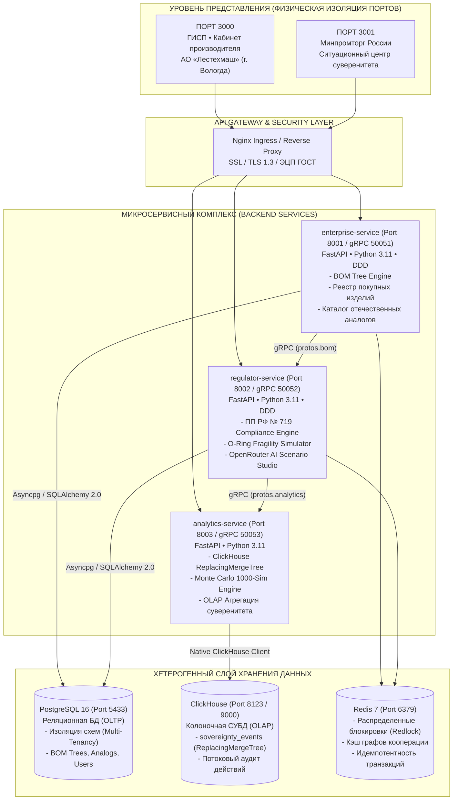

# АРХИТЕКТУРНЫЙ БЛЮПРИНТ ПЛАТФОРМЫ «МАТРЁШКА.АУДИТ»
## Сквозной аудит технологического суверенитета и риска O-Ring в многоуровневых цепочках поставок (Tier 0–3)

> **Статус документа:** Утверждено для представления в Минпромторг России и на научно-технический совет  
> **Нормативная база:** Постановление Правительства РФ от 17.07.2015 № 719, ГОСТ 2.106-96, ГОСТ Р 34.10-2012  
> **Классификация системы:** Государственно-промышленная распределенная аналитическая платформа (GovTech / Enterprise B2B)

---

## 1. СУТЬ ПРОБЛЕМЫ И ЭКОНОМИКО-МАТЕМАТИЧЕСКИЙ АППАРАТ

### 1.1. Феномен «Бумажного суверенитета»
Действующая регуляторная практика включения продукции в Реестр российской промышленной продукции (ГИСП) по ПП РФ № 719 опирается на два основных метода:
1. **Балльный метод (радиоэлектроника, приборостроение):** За каждую локализованную в РФ технологическую операцию (монтаж элементов на плату SMT, сварка корпусов, финишная сборка) начисляются баллы. При наборе нормативного порога (например, 70 баллов) изделие признается отечественным. *Уязвимость:* Происхождение кремниевых кристаллов и интегральных микросхем на плате регулятором глубоко не проверяется.
2. **Адвалорный метод (машиностроение, автопром):**
   $$\text{Loc}_{de\_jure} = \frac{\text{Цена конечного изделия} - \text{Стоимость прямого импорта Tier-1}}{\text{Цена конечного изделия}} \times 100\%$$
   При превышении порога (от 50% до 65%) продукция признается российской. *Уязвимость:* В знаменателе находится отпускная цена с маржой завода (до 40%), накладными расходами и зарплатой. Прямой импорт 1-го уровня может быть мизерным, в то время как узлы 2-го и 3-го уровней (Tier 2–3) на 100% состоят из зарубежной критической микроэлектроники и прецизионной гидравлики.

### 1.2. Математическая модель «Матрёшка.Аудит»
Система реализует сквозной рекурсивный аудит дерева изделия (BOM Tree) вплоть до листьев (Tier-3):

1. **Фактическая глубинная суверенность (De-facto Localization):**
   $$\text{Loc}_{de\_facto} = \sum_{i \in \text{Leaves}} \left( \frac{\text{Cost}_i}{\text{Total BOM Cost}} \times (1 - \text{Risk}(\text{Country}_i)) \right)$$
   где $\text{Risk}(\text{Country}_i) \in [0.0; 1.0]$:
   - РФ / Союзное государство (Беларусь): $0.00$
   - Стратегические партнеры (ЕАЭС / КНР / Индия): $0.20 - 0.25$
   - Нейтральные хабы (ОАЭ / Турция): $0.50$
   - Недружественные юрисдикции (США / ЕС / Тайвань / Япония): $1.00$

2. **Индекс скрытого дефицита суверенитета (Vulnerability Gap):**
   $$\Delta \text{Loc} = \text{Loc}_{de\_jure} - \text{Loc}_{de\_facto}$$
   *Критерий Минпромторга:* Если $\Delta \text{Loc} > 40\%$, заявка маркируется как **«Критический санкционный навес»** и подлежит блокировке до замены узлов.

3. **Индекс критичности узкого горлышка (Chokepoint Fragility Index, CFI):**
   $$\text{CFI}_i = \text{Criticality}_i \times \text{Risk}(\text{Country}_i) \times (1 - \text{AnalogAvailability}_i)$$

4. **Принцип хрупкости O-Ring («Парадокс копеечного чипа»):**
   Пусть изделие состоит из $n$ узлов. Надежность выпуска всей системы $Y$:
   $$Y = A \prod_{i=1}^{n} q_i$$
   Если хотя бы один компонент $j$ с ценой $450$ ₽ имеет $q_j = 0$ (эмбарго на поставку микроконтроллера STM32), выпуск машины за $45\,000\,000$ ₽ падает до нуля ($Y = 0$).

---

## 2. СИСТЕМНАЯ ТОПОЛОГИЯ И МИКРОСЕРВИСЫ (C4 ARCHITECTURE)



---

## 3. СПЕЦИФИКАЦИЯ МИКРОСЕРВИСОВ

### 3.1. `enterprise-service` (Портал Промышленного Предприятия)
* **Назначение:** Обслуживание конструкторских бюро и служб закупок промышленных заводов (АО «Лестехмаш»).
* **Стек:** FastAPI, Python 3.11+, SQLAlchemy 2.0 (async), Pydantic v2, gRPC.
* **Доменная структура:**
  - `app/api/v1/`: Эндпоинты управления паспортом изделия, структурой BOM, аналогами.
  - `app/domain/`: Чистая доменная математика (расчет адвалорной доли, свертка графа BOM, расчет стоимости партии).
  - `app/services/bom_service.py`: Управление составом изделия, 1-Click замена импортных чипов на российские аналоги.
  - `app/repositories/`: Паттерн репозитория для изолированного доступа к данным завода в PostgreSQL.
  - `app/grpc_server.py`: Экспорт структуры изделия в `regulator-service` по бинарному протоколу gRPC.

### 3.2. `regulator-service` (Ситуационный центр Минпромторга РФ)
* **Назначение:** Межведомственный надзор, расчет баллов ПП РФ № 719, детектирование фиктивного импортозамещения, генерация стресс-сценариев.
* **Стек:** FastAPI, Pydantic v2, OpenRouter AI SDK (Mistral-Large / Claude-3.5), gRPC client/server.
* **Ключевые модули:**
  - `ComplianceService`: Детерминированный расчет баллов (78 из 70) и скрытого разрыва ($\Delta \text{Loc} = -47.3\%$).
  - `ORingShockSimulator`: Моделирование прекращения поставок из выбранных юрисдикций (США, ЕС, Швейцария, Тайвань).
  - `AIScenarioService`: Анализ произвольных внешнеполитических шоков на естественном языке с преобразованием в матрицу рисков юрисдикций.
  - `LedgerAuditService`: Асинхронная фиксация регуляторных событий в ClickHouse OLAP.

### 3.3. `analytics-service` (Аналитическое ядро и ClickHouse OLAP)
* **Назначение:** Высоконагруженная аналитика технологического суверенитета в масштабе всей страны, стресс-тестирование методом Монте-Карло.
* **Стек:** ClickHouse (ReplacingMergeTree), FastAPI, NumPy / SciPy (стохастическое моделирование).
* **Схема данных ClickHouse:**
  ```sql
  CREATE TABLE IF NOT EXISTS matryoshka_audit.sovereignty_events (
      event_id UUID,
      event_time DateTime64(3, 'UTC'),
      product_id UInt32,
      product_name String,
      event_type LowCardinality(String),
      actor_type LowCardinality(String),
      paper_localization_pct Float32,
      defacto_localization_pct Float32,
      vulnerability_gap_pct Float32,
      chokepoints_count UInt16,
      payload_json String,
      sign_version UInt64
  ) ENGINE = ReplacingMergeTree(sign_version)
  ORDER BY (product_id, event_time, event_id);
  ```

---

## 4. ДВУХУРОВНЕВАЯ МОДЕЛЬ ВЕРИФИКАЦИИ И БЕЗОПАСНОСТИ

1. **Разделение контуров доступа (Port Isolation):**
   - **Порт 3000:** Пространство предприятия. Доступ к чертежам, заводской себестоимости, коммерческим предложениям субподрядчиков.
   - **Порт 3001:** Пространство регулятора. Доступ к надзорным матрицам рисков, межведомственным заключениям и стресс-моделированию.
   - Межпортальная утечка ролей исключена: JWT токены валидируются с привязкой к `portal_scope`.

2. **Защита коммерческой тайны кооперации (IDOR & Tenant Isolation):**
   - Цены и поставщики узлов Tier-2 и Tier-3 шифруются и доступны только заводу и аттестованному инспектору Минпромторга.
   - Конкурирующие заводы не имеют доступа к графам чужих BOM-спецификаций.

3. **Юридическая значимость (ЭЦП ГОСТ Р 34.10-2012):**
   - Каждое изменение в спецификации и каждое экспертное заключение скрепляется усиленной квалифицированной электронной подписью с записью неизменяемого следа в ClickHouse.

---

## 5. ИНЖЕНЕРНО-ДИЗАЙНЕРСКИЙ СТАНДАРТ (ANTI-SLOP GOVTECH)

1. **Отказ от любительских шаблонов:** Никаких пестрых неоновых плашек, видеоигровых шрифтов, эмодзи-флагов и студенческих сносок.
2. **Официальный ведомственный стиль:**
   - Строгая темная палитра глубокого индиго и сланца (`#0A0F1D`, `#101726`, `#1E293B`).
   - Акцентные цвета: Государственный синий (`#1D4ED8`), сдержанный изумрудный подтверждения (`#059669`), предупреждающий кармин (`#DC2626`).
   - Четкая tabular-типографика по ГОСТу для числовых и финансовых показателей.
3. **Метафора «Матрёшка.Контур»:**
   - Многоуровневое концентрическое раскрытие изделия (Контур 0 ➔ Контур 1 ➔ Контур 2 ➔ Контур 3).
   - Мгновенная трансформация «Импортное узкое горлышко» ➔ «Отечественный доверенный аналог» с наглядной перекалибровкой национального индекса устойчивости.
